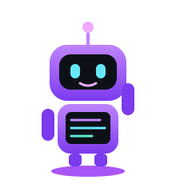
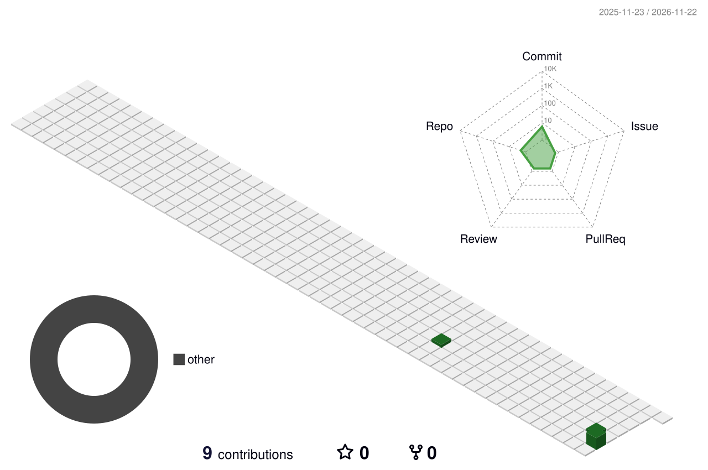

<!-- ═══════════════ BANNER ═══════════════ -->
<p align="center">
  
</p>

<h2 align="center">💻 Hi, I'm <a href="https://github.com/IsmailKairoxCo">Mohamed Ismail</a>!</h2>

<p align="center">
  <a href="https://git.io/typing-svg">
    
  </a>
</p>

<p align="center">
  <a href="https://github.com/IsmailKairoxCo"></a>
  <a href="https://www.linkedin.com/in/YOUR_LINKEDIN/"></a>
  <a href="mailto:YOUR_EMAIL"></a>
  
</p>

---

<!-- ═══════════════ ABOUT ME ═══════════════ -->
<h3>⚡ About me</h3>

<table>
<tr>
<td width="68%" valign="top">

- 🏢 **Full-Stack Engineer** at **KairoX AI Tech** 🇮🇳
- 🎨 **Frontend:** React, Next.js, TypeScript, Tailwind
- ⚙️ **Backend:** Python (FastAPI), Node.js (Express)
- 🧪 **Testing:** Pytest, Postman, Playwright, functional & API tests
- 🔐 **Security:** OWASP ZAP scans, auth & RBAC checks
- 🤖 **AI Researcher:** LLMs, AI agents, RAG, speech AI
- 🔁 **Automation:** n8n workflows & integrations
- 🗄️ **Data:** PostgreSQL · Supabase · Redis · Celery
- 🔭 Currently working on **KairoX AI ERP**
- 🌱 Exploring multi-agent systems & AI security
- 💬 Ask me about full-stack, testing, AI & n8n

</td>
<td width="32%" align="center" valign="middle">
  
</td>
</tr>
</table>

```python
class Ismail:
    role       = "Full-Stack Engineer • Testing • Security • AI"
    company    = "KairoX AI Tech 🇮🇳"
    frontend   = ["React", "Next.js", "TypeScript", "Tailwind CSS"]
    backend    = ["Python", "FastAPI", "Node.js", "Express", "REST APIs"]
    data       = ["PostgreSQL", "Supabase", "Redis", "Celery"]
    testing    = ["Pytest", "Postman", "Playwright", "Functional & API testing"]
    security   = ["OWASP ZAP", "OWASP Top 10", "Auth & RBAC", "Security reviews"]
    ai         = ["LLMs", "AI Agents", "RAG", "Speech AI"]
    automation = ["n8n", "Webhooks", "API integrations"]

    def mission(self):
        return "Build it end to end, test it hard, and keep it secure."
```

---

<!-- ═══════════════ STATS ═══════════════ -->
<h3 align="center">📊 GitHub Stats</h3>

<p align="center">
  
  
</p>

<!-- ═══════════════ 3D CONTRIBUTIONS ═══════════════ -->
<p align="center">
  <picture>
    <source media="(prefers-color-scheme: dark)" srcset="./profile-3d-contrib/profile-night-green.svg" />
    
  </picture>
</p>

<!-- ═══════════════ CONTRIBUTION GRAPH ═══════════════ -->
<p align="center">
  
</p>

---

<!-- ═══════════════ TECH ═══════════════ -->
<h3 align="center">⚔️ Languages · Frameworks · Tools ⚔️</h3>

<p align="center">
  
</p>

<p align="center">
  
  
  
  
  
  
</p>

---

<!-- ═══════════════ FEATURED PROJECT ═══════════════ -->
<h3 align="center">🏭 Featured Project: KairoX AI ERP 🏭</h3>

<p align="center"><i>🔒 Private / commercial product · factory operating system for manufacturing<br/>My role: Full-Stack Engineer (frontend, backend, testing & security)</i></p>

| 🧩 My Work | ⚙️ Engineering |
|---|---|
| 🎨 **Frontend:** built ERP screens for production, inventory, orders and dashboards | ⚡ FastAPI + SQLAlchemy 2.0 (async) + Pydantic v2 |
| ⚙️ **Backend:** developed API endpoints and business logic for ERP modules | ⚛️ React / Next.js frontend |
| 🧪 **Testing:** wrote functional and API test suites, Postman collections and tester packs | 🐘 PostgreSQL, Redis & Celery workers |
| 🔐 **Security:** ran OWASP ZAP scans, checked auth and role-based access, fixed findings | 🐳 Docker-based local and server stacks |
| 🤖 **AI:** tested the AI assistant and agent features for correct, safe answers | 🧪 Pytest, Postman, test reports per release |
| 📄 **Docs:** test scenarios, bug reports and handover notes for the team | 🛡️ Role-based access & security-first design |

---

<!-- ═══════════════ RESEARCH ═══════════════ -->
<h3 align="center">🔬 AI Research: Free Platforms 🔬</h3>

<p align="center"><i>🔒 Research repo · free, open-source AI building blocks that run on your own PC,<br/>tested and benchmarked to choose a hosting stack for AI chat and voice assistants</i></p>

<details open>
<summary><b>🗣️ Speech-to-Text (STT)</b></summary>

| Project | What it does | Stack |
|---|---|---|
| 🎙️ SST Text Free | Speech-to-text web app (Whisper turbo) | sherpa-onnx · Node.js |
| ⚡ Parakeet STT | Fast STT with NVIDIA Parakeet-TDT 0.6B, ~20× faster than Whisper on CPU | sherpa-onnx int8 |
| 🔊 Phonon STT | English STT, 158 MB model, ~35× real-time, ~30 concurrent streams | CPU |
| 🧠 Whisper Small INT8 | 99-language STT on CPU + LibriSpeech accuracy benchmark | whisper.cpp · Docker |
| 📊 Free STT | 3 STT models compared under a 10/15-user load test (CPU, RAM, disk, GPU) | Faster-Whisper · Omnilingual ASR · Docker |

</details>

<details>
<summary><b>🔉 Voice Assistants & Text-to-Speech</b></summary>

| Project | What it does | Stack |
|---|---|---|
| 🗨️ TTS Text Free | Text-to-speech app with 3 engines | Chatterbox · Piper · Kokoro · WSL2 CUDA |
| 📞 LiveKit Free | Real-time voice assistant | LiveKit server + LiveKit Agents · Ollama |
| ⏱️ LiveKit Faster-Whisper | Self-hosted voice pipeline that measures cold vs warm latency step by step | LiveKit · Faster-Whisper INT8 |
| 🤖 Pipecat | Real-time voice assistant over WebRTC with Smart Turn | Pipecat |

</details>

<details>
<summary><b>🧠 LLMs, Embeddings & RAG</b></summary>

| Project | What it does | Stack |
|---|---|---|
| 💬 AI Brain UI | Local LLM chat UI + sales bot | Ollama · llama.cpp · vLLM · SGLang |
| 🔎 Qwen Embedding | Semantic search page + OpenAI-compatible embedding API, 3 ways | Qwen3-Embedding · Ollama · HF TEI |
| 🥊 Embedding Fight | Benchmark comparing 17 open-source embedding models | Python |
| 🔭 Phoenix | AI chatbot with full LLM tracing | Groq · Arize Phoenix |

</details>

<details>
<summary><b>☁️ Infrastructure, Monitoring & Load Testing</b></summary>

| Project | What it does | Stack |
|---|---|---|
| 🔥 Server Smokey | Dockerised chatbot + 10-user load test to estimate hosting cost | Docker |
| 📈 SigNoz Monitoring | Server, app, Redis, Celery and Docker logs + uptime checks | SigNoz · Uptime Kuma |
| 🗄️ Cloudflare R2 Storage | Upload, browse, share and 3D-preview files (GLB/STL/OBJ/FBX) | Cloudflare R2 · three.js |
| 📬 Stalwart Mail | Setup guide for a self-hosted mail server | Stalwart |

</details>

---

<!-- ═══════════════ SNAKE ═══════════════ -->
<h3 align="center">🐍 Contribution Snake 🐍</h3>

<p align="center">
  <picture>
    <source media="(prefers-color-scheme: dark)" srcset="https://raw.githubusercontent.com/IsmailKairoxCo/IsmailKairoxCo/output/github-snake-dark.svg" />
    
  </picture>
</p>

---

<!-- ═══════════════ HOW I WORK ═══════════════ -->
<table align="center">
<tr>
<td align="center" width="25%">🧱<br/><b>End to End</b><br/><sub>From the UI to the database</sub></td>
<td align="center" width="25%">🧪<br/><b>Test Everything</b><br/><sub>Evidence before release</sub></td>
<td align="center" width="25%">🔐<br/><b>Secure by Default</b><br/><sub>Scan, check, fix</sub></td>
<td align="center" width="25%">🤖<br/><b>Automate</b><br/><sub>AI and n8n where it saves time</sub></td>
</tr>
</table>

<p align="center"><b>⭐ "Build it, break it, secure it, ship it." ⭐</b></p>

<p align="center">
  
</p>
